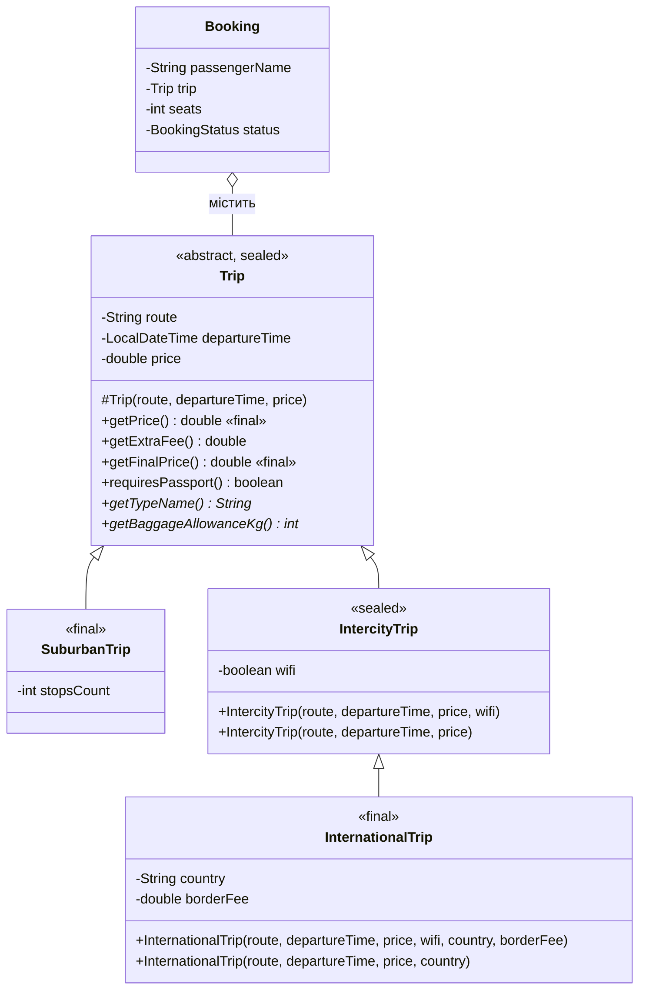

# ЛР №6. Реалізація ієрархії класів на основі наслідування

**Тема проєкту №14 — система бронювання квитків на автобус.**

## Предметна область

До ЛР №5 рейс у бронюванні був просто рядком `route` і числом `pricePerSeat`, тож усі рейси поводилися однаково. Але автовокзал продає квитки на різні види рейсів: приміські (багато зупинок, мало багажу, квиток у водія), міжміські (Wi-Fi, більше багажу) і міжнародні (перетин кордону, закордонний паспорт, прикордонний збір). У ЛР №6 рейс винесено в окрему ієрархію класів, а `Booking` тепер містить об'єкт `Trip`.

## Ієрархія

Перевірка «is-a»:
- приміський рейс **є** рейсом;
- міжміський рейс **є** рейсом;
- міжнародний рейс **є** міжміським рейсом (далекий маршрут, той самий автобус і умови, плюс кордон).



## Рівень 1

- Спільні поля `route`, `departureTime`, `price`, конструктор і методи — у `Trip`. У підкласах лише свої поля: `stopsCount`, `wifi`, `country` і `borderFee`. Усі поля `private`: підкласи працюють з ними через гетери, тому базовий клас сам контролює свій стан (наприклад, перевірку ціни).
- Конструктори підкласів викликають `super(...)`.
- Кожен підклас перевизначає `getTypeName()`, `getBaggageAllowanceKg()` і `toString()` (через `super.toString()` + свої поля). `InternationalTrip` додатково перевизначає `getExtraFee()` (прикордонний збір) і `requiresPassport()`.
- Поліморфізм: у `TripDemo` масив `Trip[]` містить об'єкти різних підкласів, і в циклі для кожного викликаються перевизначені методи.

## Рівень 2

- **Абстрактний клас.** Просто «рейс» без виду автовокзал не продає, тому `Trip` абстрактний. `getTypeName()` і `getBaggageAllowanceKg()` — абстрактні: у базовому класі для них немає осмисленого значення за замовчуванням (норма багажу різна для кожного виду рейсу), а компілятор змусить кожен новий підклас їх реалізувати.
- **Три рівні.** `Trip → IntercityTrip → InternationalTrip`. Ланцюжок конструкторів видно в пункті меню 5: спочатку відпрацьовує `Trip`, потім `IntercityTrip`, потім `InternationalTrip`. Так відбувається, тому що першим рядком кожного конструктора є `super(...)`: об'єкт будується від базового класу до похідного, і підклас отримує вже ініціалізовану базову частину. Повідомлення друкуються лише в демо (`Trip.setTraceConstructors(true)`), щоб не засмічувати решту виводу.
- **this(...).** `IntercityTrip(route, departureTime, price)` → `this(..., true)` (у міжміських автобусах Wi-Fi є за замовчуванням), `InternationalTrip(route, departureTime, price, country)` → `this(..., true, country, DEFAULT_BORDER_FEE)`. Ініціалізація пишеться один раз — у повному конструкторі.
- **final.** `getPrice()` і `getFinalPrice()` — `final`: базова ціна квитка і формула «ціна + збори» однакові для всіх рейсів, підклас може лише додати свій збір через `getExtraFee()`, а не підмінити сам розрахунок. `SuburbanTrip` і `InternationalTrip` — `final`-класи: у домені в них немає підвидів.
- **instanceof.** Через посилання `Trip` специфічні методи (`getCountry()`, `getStopsCount()`, `hasWifi()`) недоступні. Статичний (оголошений) тип змінної — `Trip`, він визначає, які методи можна викликати на етапі компіляції. Динамічний (фактичний) тип — клас створеного об'єкта, він визначає, яка реалізація перевизначеного методу виконається. Pattern matching `if (trip instanceof InternationalTrip international)` перевіряє фактичний тип і одразу дає змінну потрібного типу; для `IntercityTrip` показано явне приведення типу.

## Рівень 3

### equals() і hashCode()
Кожен клас ієрархії перевизначає `equals()`/`hashCode()`, підкласи додають свої поля до порівняння базового класу.

Використано `getClass()`, а не `instanceof`. Демо (пункт меню 5) порівнює міжміський рейс «Чернівці — Сучава» і міжнародний рейс з тими самими маршрутом, часом, ціною, Wi-Fi і нульовим збором:

| Підхід | `trip.equals(internationalTrip)` | `internationalTrip.equals(trip)` |
|---|---|---|
| `getClass()` (обрано) | false | false |
| `instanceof` | true | false |

З `instanceof` у `IntercityTrip.equals()` міжнародний рейс «є» `IntercityTrip` і порівнюється як рівний, а `InternationalTrip.equals()` міжміський рейс відкидає — симетрія порушена, і, наприклад, `HashSet` поводитиметься непередбачувано. `getClass()` вважає рівними лише об'єкти одного класу, тому симетрія зберігається. Це правильно і за змістом: рейс із перетином кордону — інший рейс, навіть якщо маршрут той самий.

### Композиція замість наслідування
`Booking` **містить** `Trip`, а не успадковує його. Твердження «бронювання є рейсом» хибне. Якби `Booking extends Trip`, кожне бронювання було б окремим рейсом: десять пасажирів одного автобуса означали б десять різних «рейсів» з копіями маршруту, часу й ціни, і зміна часу відправлення не потрапила б у вже створені бронювання. До того ж для кожного виду рейсу довелося б робити свій клас бронювання (`SuburbanBooking`, `InternationalBooking`...). Через композицію багато бронювань посилаються на один об'єкт `Trip`, а вартість рахується через делегування: `seats * trip.getFinalPrice()`.

### sealed і switch з pattern matching
`Trip` — `sealed ... permits SuburbanTrip, IntercityTrip`, `IntercityTrip` — `sealed ... permits InternationalTrip`. Компілятор знає повний список підкласів, тому `switch` у `TripDemo.describeDocuments()` перевіряється на вичерпність без `default`: якщо додати новий підклас у `permits` і не обробити його у `switch`, код не скомпілюється. Відкриту ієрархію хтось міг би розширити будь-де, і `switch` тоді потребував би `default`.

## Інші зміни
- Перевірка ціни (`InvalidPriceException`) переїхала з `Booking` у конструктор `Trip`.
- Тарифи (ЛР4–5) рахують від ціни квитка зі зборами (`getFinalPrice()`), а каса нагадує про закордонний паспорт для міжнародних рейсів.

## Запуск

```bash
javac -d out $(find src -name "*.java")
java -cp out bus.Main
```

Новий пункт меню: `5` — ієрархія рейсів (поліморфізм, конструктори, instanceof, equals, композиція).
