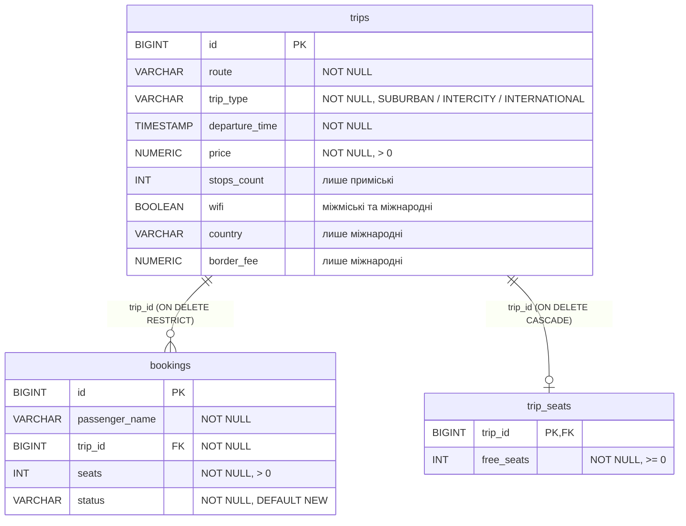

# ЛР №10. Maven. Робота з реляційною БД через JDBC

**Тема проєкту №14 — система бронювання квитків на автобус.**

## Предметна область

Рейси (`Trip` та підкласи з ЛР6), бронювання (`Booking`) і вільні місця в кожному рейсі. Сховище в пам'яті з ЛР7–9 доповнено сховищем у БД. Інтерфейси `CRUDService<T>` і `TripService` не змінювалися: `CrudDemo` з ЛР7–9 без жодної правки працює і з `InMemoryTripService` (пункт меню 6), і з `JdbcTripService` (пункт меню 7).

## Запуск з нуля

Потрібні JDK 21+ і Maven. СУБД — **H2 у файловому режимі**: окремо нічого встановлювати не треба, драйвер підтягує Maven, а база створюється сама в папці `data/` при першому запуску.

```bash
mvn compile
mvn exec:java
```

1. `mvn compile` завантажує залежності з `pom.xml` (драйвер H2) і компілює проєкт.
2. Параметри підключення — у `src/main/resources/application.properties` (`db.url`, `db.user`, `db.password`, розмір пулу). Для H2 змінювати нічого не потрібно.
3. На старті `DatabaseInitializer` виконує `init.sql`. Скрипт ідемпотентний (`CREATE TABLE IF NOT EXISTS`, `CREATE INDEX IF NOT EXISTS`), тому повторний запуск нічого не ламає. Тестові дані зберігаються через `save()` (оновити або додати за id), тож при повторних запусках вони не дублюються.
4. Щоб почати з порожньої бази, достатньо видалити папку `data/`.

Пункти меню ЛР10: `7` — CRUD у БД, `8` — транзакція з відкатом, `9` — SQL-ін'єкція, `10` — пакетна вставка, `11` — посторінкове читання.

## Структура

```
pom.xml
src/main/java/bus/
├── db/DBConnection.java                 Singleton з пулом з'єднань (DataSource)
├── db/DatabaseInitializer.java          виконання init.sql на старті
├── exception/DataAccessException.java
├── service/jdbc/
│   ├── AbstractJdbcCrudService.java     Template Method для JDBC-сервісів
│   ├── JdbcTripService.java             implements TripService
│   ├── JdbcBookingService.java          друга сутність через абстрактний клас
│   ├── JdbcSeatService.java             вільні місця в рейсах
│   └── BookingPlacementService.java     транзакція «забронювати місця»
└── demo/DbDemo.java                     пункти меню 8–11
src/main/resources/
├── application.properties
└── init.sql
```

## Maven

`pom.xml`: `groupId` `ua.bus`, `artifactId` `bus-booking`, `version` `1.0-SNAPSHOT`, Java 21 (`maven.compiler.release`), кодування UTF-8. Залежність — `com.h2database:h2`. `exec-maven-plugin` з `mainClass` `bus.Main` дає запуск через `mvn exec:java`. Код перенесено в стандартну структуру `src/main/java`, ресурси — у `src/main/resources`.

## Схема БД



Найкращі практики в `init.sql`:
- первинний ключ у кожній таблиці;
- `NOT NULL` для обов'язкових полів;
- `NUMERIC(10, 2)` для грошей: `FLOAT`/`DOUBLE` зберігають числа у двійковому вигляді, тому 0.1 + 0.2 ≠ 0.3, а для цін квитків це неприпустимо. У Java гроші читаються через `getBigDecimal()`; `TIMESTAMP` для часу відправлення читається як `LocalDateTime`;
- `CHECK`: ціна > 0, кількість місць > 0, вільних місць ≥ 0, статус і тип рейсу лише з дозволеного списку. `chk_trips_fields` перевіряє, що в кожного типу рейсу заповнені саме його поля (у приміського — зупинки, у міжнародного — країна і збір тощо);
- `UNIQUE (route, departure_time)`: два рейси одного маршруту не можуть відправлятися в той самий час — це дубль. Той самий маршрут в інший час дозволений (у демо є ранковий і вечірній «Чернівці — Київ»).

Ієрархія рейсів зберігається в одній таблиці (`trip_type` + стовпці підкласів, зайві — `NULL`). У `JdbcTripService.mapRow()` за `trip_type` створюється потрібний підклас, а в `setParameters()` використано `switch` з pattern matching по sealed-ієрархії з ЛР6.

**ON DELETE.**
- `bookings → trips`: **RESTRICT**. Не можна видалити рейс, на який уже продано квитки: з CASCADE пасажири втратили б свої бронювання без попередження, а з SET NULL лишилися б бронювання «нікуди». Рейс спершу треба скасувати і повернути гроші. У демо (пункт 8) спроба видалити такий рейс закінчується повідомленням про помилку.
- `trip_seats → trips`: **CASCADE**. Лічильник вільних місць без рейсу нічого не означає, тому видаляється разом із рейсом.

## Рівень 1

- **DBConnection — Singleton.** Приватний конструктор, `static synchronized getInstance()`. URL, користувач і пароль читаються з `application.properties`, у коді їх немає.
- **JdbcTripService implements TripService** — `findById`, `save` (спершу `UPDATE`, якщо оновлено 0 рядків — `INSERT`), `delete`, `findAllSortedByName`. Тільки `PreparedStatement`. `Connection`, `PreparedStatement` і `ResultSet` закриваються через try-with-resources. Якщо рядка немає, `findById` кидає `EntityNotFoundException` з ЛР7. `SQLException` загортається в неперевірений `DataAccessException`, щоб не міняти сигнатури інтерфейсу.

## Рівень 2

- **Друга таблиця і сутність** — `bookings` (`JdbcBookingService`), зв'язок «один рейс — багато бронювань» через `FOREIGN KEY`.
- **`findAllSortedByNameAndByDepartureTime()`** — `ORDER BY route, departure_time, id` у SQL. `findAllSortedByName()` у JDBC-версії теж сортує в БД (`ORDER BY route, id`).
- **`mapRow(ResultSet)`** — перетворення рядка на об'єкт в одному місці. Всі запити (`findById`, `findAllSorted...`, `findPage`, `findByRoute`) йдуть через спільний `query()`, який викликає `mapRow()`.
- **Автоматичний `init.sql`** — див. «Запуск з нуля».
- **Транзакція (пункт 8).** `BookingPlacementService.placeBooking()` в одній транзакції додає рядок у `bookings` і зменшує `free_seats` у `trip_seats`: `setAutoCommit(false)` → два запити → `commit()`, при помилці `rollback()`. Демо: у рейсі «Чернівці — Варшава» 5 вільних місць; бронювання на 2 місця проходить (лишається 3); бронювання на 10 місць вставляє рядок у `bookings`, але `UPDATE trip_seats` порушує `CHECK (free_seats >= 0)` → `rollback()`. У результаті вільних місць так і лишається 3, а бронювання #502 в таблиці немає — відкотилась і вставка, що вже виконалась.

### SQL-ін'єкція (пункт 9)

«Поганий» метод — склеювання рядка в `Statement`. В основному коді його немає, тільки тут:

```java
public List<Trip> findByRouteUnsafe(String route) {
    String sql = "SELECT * FROM trips WHERE route = '" + route + "'";
    try (Connection connection = getConnection();
         Statement statement = connection.createStatement();
         ResultSet rs = statement.executeQuery(sql)) {
        ...
    }
}
```

Для введення `' OR '1'='1` виходить запит:

```sql
SELECT * FROM trips WHERE route = '' OR '1'='1'
```

Умова завжди істинна, і метод повертає **всі** рейси (перевірено на тестовій базі: 5 рядків замість 0). Так само можна було б дописати `; DROP TABLE ...` або витягнути чужі бронювання з іменами пасажирів.

«Хороший» метод `JdbcTripService.findByRoute()`:

```java
return query(getSelectSql() + " WHERE route = ?", route);
```

У `PreparedStatement` SQL-текст компілюється окремо від даних, а значення передається як параметр. Рядок `' OR '1'='1` — це просто назва маршруту, якого немає, тому результат порожній.

## Рівень 3

### Template Method: AbstractJdbcCrudService\<T extends BaseEntity\>

Скелет усіх операцій (`findById`, `save`, `delete`, `findAllSorted`, `findAllSortedByName`, `findPage`, `query`) з відкриттям з'єднання, try-with-resources та обробкою `SQLException` написаний один раз в абстрактному класі. Підкласи надають лише «змінні кроки»: назву таблиці, SQL-запити (`getSelectSql`, `getInsertSql`, `getUpdateSql`), стовпець для сортування за іменем, `mapRow(ResultSet)` і `setParameters(PreparedStatement, T)`. `INSERT` і `UPDATE` мають однаковий порядок параметрів (id останній), тому одного `setParameters()` досить для обох. `JdbcBookingService` реалізовано вже повністю через цей клас.

Назви таблиць і стовпців підставляються в SQL рядком, але вони беруться з коду підкласу, а не з введення користувача, тому ін'єкції тут немає. Усі значення — тільки через параметри `?`.

### Singleton з одним Connection — у чому проблема

Якби `DBConnection` тримав один спільний `Connection`:
- **багатопотоковість** — `Connection` не розрахований на одночасне використання з кількох потоків. Якщо дві каси автовокзалу бронюють одночасно, їхні запити перемішуються або блокують одне одного;
- **розрив з'єднання** — після тайм-ауту сервера чи перезапуску БД єдине з'єднання «мертве», і вся програма падає, доки її не перезапустять;
- **транзакції** — `setAutoCommit(false)` і `commit()/rollback()` діють на все з'єднання. Якщо одна каса почала транзакцію бронювання, а інша в цей час виконала свій запит, той потрапить у чужу транзакцію і відкотиться або закомітиться разом із нею;
- **закриття** — try-with-resources у будь-якому методі закрив би спільне з'єднання для всіх інших.

**Реалізовано варіант b: Singleton тримає `DataSource`, а не `Connection`.** `DBConnection` створює пул з'єднань H2 (`JdbcConnectionPool`, реалізує `javax.sql.DataSource`, розмір — `db.pool.max-connections`). `getConnection()` щоразу видає окреме з'єднання з пулу, а `close()` у try-with-resources повертає його в пул. Кожна транзакція має своє з'єднання. `getInstance()` синхронізований, тож пул створюється рівно один раз навіть при паралельних викликах. При виході з програми `DBConnection.shutdown()` закриває пул.

### Пакетна вставка (пункт 10)

5000 рейсів вставляються двома способами (той самий `INSERT`, той самий `PreparedStatement`):
- по одному: `executeUpdate()` для кожного запису в режимі автокоміту;
- пакетом: `addBatch()` + `executeBatch()` кожні 500 записів, одна транзакція з `commit()` в кінці.

Результати (H2 у файловому режимі, три запуски):

| Спосіб | Запуск 1 | Запуск 2 | Запуск 3 |
|---|---|---|---|
| По одному | 826 мс | 804 мс | 865 мс |
| Пакетом | 513 мс | 264 мс | 277 мс |
| Прискорення | ×1.6 | ×3.0 | ×3.1 |

Пакетна вставка в ~3 рази швидша: менше звернень до драйвера і БД, а головне — один коміт замість 5000 (кожен коміт у файловій БД — запис на диск). Перший запуск повільніший, бо JVM ще «розігрівається». Із серверною СУБД різниця ще більша, бо кожен окремий запит — це ще й мережевий обмін. Після вимірювання тестові записи видаляються.

> Час залежить від комп'ютера: після запуску пункту 10 на своєму ПК можна вписати свої числа.

### Посторінкове читання (пункт 11)

`findPage(page, pageSize)` в `AbstractJdbcCrudService`: `ORDER BY id LIMIT ? OFFSET ?`. `ORDER BY` обов'язковий, інакше порядок рядків між сторінками не гарантований.

`findAll()` без обмежень небезпечний на великій таблиці: усі рядки за один раз передаються з БД і стають об'єктами в пам'яті. Розклад автовокзалу за кілька років — це сотні тисяч рейсів, і такий запит означає довге очікування, великий трафік і `OutOfMemoryError`, хоча касиру потрібна лише перша сторінка. Посторінкове читання тримає в пам'яті одну сторінку.
